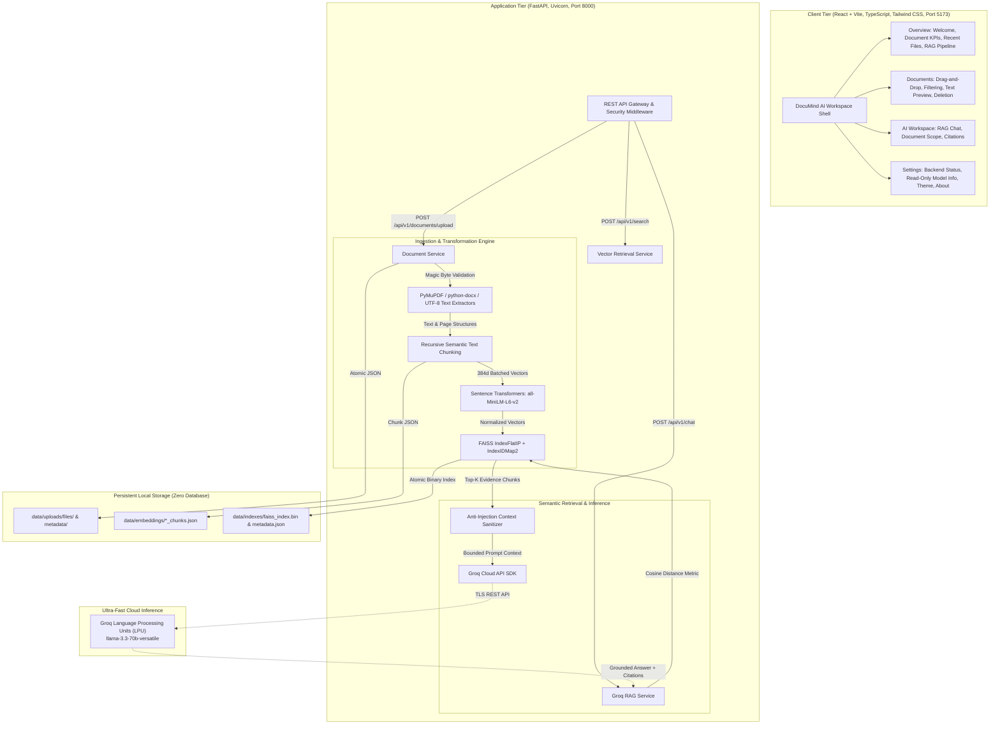

# 🧠 DocuMind AI

> **High-Performance, Local & Cloud-Augmented Document Intelligence Engine**  
> Private, database-free Retrieval-Augmented Generation (RAG) powered by **FAISS**, **Sentence Transformers**, **PyMuPDF**, **FastAPI**, and **React + Vite**.

---

## 📌 Architecture Overview

DocuMind AI is engineered as an enterprise-grade document intelligence system designed to ingest, index, and query enterprise documents (**PDF**, **DOCX**, **TXT**) with sub-second latency while preserving complete data locality and privacy.



---

## ⚡ FAISS Vector Indexing & Semantic Retrieval (Phase 6)

DocuMind AI implements **FAISS (Facebook AI Similarity Search)** as its dedicated local vector indexing and retrieval engine:

### Metric & Normalization Consistency
- **Similarity Metric**: Inner Product (`faiss.IndexFlatIP`) wrapped in `faiss.IndexIDMap2`.
- **Mathematical Equivalence**: Because Sentence Transformers produces L2-normalized unit embeddings ($\|u\|_2 = 1.0$), the Inner Product strictly equals **Cosine Similarity**:
  $$\text{Cosine Similarity}(u, v) = \frac{u \cdot v}{\|u\|_2 \|v\|_2} = u \cdot v$$
- **Metrics Reported**:
  - `score`: Cosine similarity ranging from $-1.0$ to $+1.0$ (higher is more similar).
  - `distance`: Cosine distance defined as $\max(0.0, 1.0 - \text{score})$ (lower is closer).

### Index Persistence & Storage Layout
All vector index data and metadata mappings are maintained outside public frontend assets under `data/indexes/`:
1. `data/indexes/faiss_index.bin`: Binary serialized FAISS `IndexIDMap2` vector index.
2. `data/indexes/index_metadata.json`: Atomic metadata dictionary mapping 64-bit integer vector IDs to rich document chunk metadata (chunk ID, document ID, filename, page number, heading, section index, normalized text).

### Atomic Writes & Corruption Protection
- **Atomic Serialization**: When saving, FAISS binary indexes are written to temporary staging files (`faiss_index.bin.tmp`), and metadata is written to `index_metadata.json.tmp` before committing via `os.replace`. This eliminates partial writes or corruptions from unexpected shutdowns.
- **Self-Healing Auto-Recovery**: If `faiss_index.bin` is missing or corrupted, the system automatically detects the condition on startup and triggers `rebuild_index_from_storage()`. This scans all stored document chunks in `data/embeddings/*_chunks.json` and reconstructs the index without data loss.

---

## ⚡ Groq-Powered Retrieval-Augmented Generation (RAG) (Phase 7)

DocuMind AI integrates the official **Groq Cloud API** SDK for fast, grounded question answering over indexed documents:

### Architecture & Grounded Generation Flow
1. **Context Retrieval**: The user question is queried against the FAISS vector index using dense 384-dimensional cosine similarity to retrieve the top $K$ relevant document chunks.
2. **Context Assembly**: Retrieved chunks are sanitized and structured into citation blocks:
   `[Source N] (File: filename.pdf, Page P, Chunk ID: chunk_xyz): <content>`
3. **Safety & Anti-Prompt-Injection Safeguards**:
   - System prompts explicitly instruct the LLM to treat document context as untrusted external reference data and strictly ignore any prompt injection attempts or instructions found inside uploaded files.
   - Grounded refusal: If retrieved chunks do not contain sufficient evidence to answer the question, the system clearly and honestly returns: *"The provided documents do not contain sufficient evidence to answer this question."*
4. **Official Groq SDK Client**: Invokes Groq's Language Processing Units (LPUs) using Meta's flagship `llama-3.3-70b-versatile` model (128k context window).
5. **Exact Source Citation**: Returns structured answers alongside an immutable list of `ChatSource` references matching the exact chunks retrieved from FAISS (including filename, page number, and chunk ID). Never fabricates page numbers or sources.

### Security & Privacy Protections
- **Zero Client Credential Leakage**: `GROQ_API_KEY` is loaded exclusively from backend environment variables and is never exposed to the frontend or included in health/diagnostics responses.
- **Sanitized Logging**: Prompts, raw document content, and API credentials are kept out of server logs; only sanitized telemetry (token counts, latency, source count) is logged.
- **Error Mapping**:
  - Missing/placeholder API key $\to$ HTTP 503 (`GROQ_NOT_CONFIGURED`)
  - Rate limits $\to$ HTTP 429 (`GROQ_RATE_LIMIT_EXCEEDED`)
  - Inference timeout $\to$ HTTP 504 (`GROQ_TIMEOUT`)
  - Network connectivity error $\to$ HTTP 503 (`GROQ_CONNECTION_ERROR`)
  - Invalid model or bad request $\to$ HTTP 400 (`INVALID_MODEL_OR_REQUEST`)


---

## 🧠 Semantic Embedding Model Specifications

DocuMind AI utilizes **`all-MiniLM-L6-v2`** from Sentence Transformers for local, privacy-preserving semantic embedding generation:

| Property | Value | Notes |
| :--- | :--- | :--- |
| **Model Name** | `all-MiniLM-L6-v2` | Configurable in `.env` / `Settings` |
| **Vector Dimension** | **384** dimensions | Dense float32 unit vectors (L2 normalized) |
| **Disk & Download Size** | **~80 MB** (compact & lightweight) | Stored in `~/.cache/huggingface/hub/` |
| **Max Context Window** | **256 word pieces / tokens** (~200 words) | Handled by our chunking service |
| **Hardware Target** | **CPU by default** (CUDA optional) | Optimized with `torch.inference_mode()` |
| **Inference Latency** | **~10–25 ms per batch** on standard x86 CPU | Highly responsive local execution |
| **Limitations** | English-optimized semantic representation; text beyond 256 tokens is truncated if unchunked. Not suited for raw multi-lingual search without cross-lingual models. |
| **Download Requirements** | One-time automated download from HuggingFace Hub (~80 MB) on initial invocation. Fully offline operational thereafter. |

---

## 🛠️ Technology Stack

| Component | Technology | Description |
| :--- | :--- | :--- |
| **Frontend Framework** | React 19 + TypeScript + Vite | Rapid development, modern ES module bundling |
| **Styling & UI** | Tailwind CSS + shadcn/ui | Tailored navy, violet and sapphire aesthetic |
| **Icons** | Lucide React | High-performance SVG iconography |
| **Backend Framework** | FastAPI (Python 3.12) | Asynchronous, auto-documented OpenAPI |
| **Validation** | Pydantic v2 + Pydantic-Settings | Strict type validation and environment loading |
| **Vector Database** | FAISS (`faiss-cpu` 1.15+) | High-speed in-memory vector index with `IndexIDMap2` and `IndexFlatIP` |
| **Local Embeddings** | Sentence Transformers (`all-MiniLM-L6-v2`) | Local 384-dimensional dense vectors in `torch.inference_mode` |
| **Text Chunking** | `ChunkingService` | Sliding window with paragraph/sentence/word boundary snapping |
| **PDF Extraction** | PyMuPDF (`pymupdf` 1.28+) | High-performance text extraction, page metadata, scanned/encrypted detection |
| **DOCX Extraction** | `python-docx` (1.2+) | Paragraphs, hierarchical headings, and table content extraction |
| **TXT Extraction** | Multi-encoding safe decoder | `utf-8-sig`, `utf-8`, `latin-1`, `cp1252` fallback with binary null-byte detection |
| **Storage Architecture**| Local JSON + Atomic File Ops | Zero-DB design: `atomic_write_json`, `os.replace`, boundary-checked paths |
| **LLM Inference** | Groq Cloud API | Ultra-low latency `llama-3.3-70b-versatile` (Phase 7) |

---

## 📁 Repository Directory Structure

```text
Documind AI/
├── .env.example              # Central configuration template
├── .env                      # Local environment configuration (ignored by git)
├── .gitignore                # Root gitignore rules
├── README.md                 # Complete documentation & PowerShell guides
├── backend/
│   ├── app/
│   │   ├── __init__.py       # Backend package marker
│   │   ├── main.py           # FastAPI entrypoint, middleware, lifespan & routing
│   │   ├── api/
│   │   │   ├── __init__.py
│   │   │   ├── api.py        # Central versioned API v1 router
│   │   │   └── routes/
│   │   │       ├── __init__.py
│   │   │       ├── health.py # GET /health & diagnostic routes
│   │   │       ├── documents.py # Upload, chunks, embed, details, delete, validate
│   │   │       └── search.py # POST /search, GET /search/status, POST /search/rebuild
│   │   ├── core/
│   │   │   ├── __init__.py
│   │   │   ├── config.py     # Pydantic v2 BaseSettings (chunk sizes, model, device, paths)
│   │   │   ├── exceptions.py # Centralized exceptions (EmbeddingModel, InvalidChunk, etc.)
│   │   │   └── logging.py    # Structured logging & request timer middleware
│   │   ├── schemas/
│   │   │   ├── __init__.py
│   │   │   ├── common.py     # BaseResponse, APIResponse[T], ErrorResponse
│   │   │   ├── health.py     # HealthResponse & DependencyHealth
│   │   │   ├── documents.py  # DocumentDetail, DocumentMetadata, DocumentUploadResponse
│   │   │   ├── chunks.py     # DocumentChunk, ChunkListResponse, DocumentEmbedResponse
│   │   │   └── search.py     # SearchRequest, SearchResponse, SearchResultChunk, IndexStatusResponse
│   │   ├── services/
│   │   │   ├── __init__.py
│   │   │   ├── base.py       # BaseService, VectorService, LLMService placeholders
│   │   │   ├── chunking_service.py # ChunkingService & normalize_text
│   │   │   ├── embedding_service.py # EmbeddingService (SentenceTransformers, CPU, batching)
│   │   │   ├── vector_service.py # VectorService (FAISS IndexIDMap2, persistence, retrieval)
│   │   │   ├── document_service.py # DocumentService: ingestion, storage, lifecycle
│   │   │   └── extractor.py  # Format extraction engine (PDF, DOCX, TXT)
│   │   ├── utils/
│   │   │   ├── __init__.py
│   │   │   └── helpers.py    # atomic_write_json, sanitize_filename, validate_document_id
│   │   └── tests/
│   │       ├── __init__.py
│   │       ├── conftest.py   # TestClient fixture with lifespan support
│   │       ├── test_health.py # Health endpoint & schema verification
│   │       ├── test_exceptions.py # CORS, middleware & credentials safety
│   │       ├── test_invalid_requests.py # 404, 405, 422 validation tests
│   │       ├── test_documents.py # Phase 4 upload, extraction, error & security tests
│   │       ├── test_phase5.py # Phase 5 chunking, boundary, overlap & embedding tests
│   │       └── test_phase6.py # Phase 6 FAISS search, persistence, restart & recovery tests
│   ├── requirements.txt      # Backend dependencies (fastapi, faiss-cpu, sentence-transformers)
│   └── tests/
│       ├── __init__.py
│       └── test_health.py    # Backward-compatible pytest runner forwarding to app/tests
├── data/
│   ├── indexes/              # FAISS binary vector index (faiss_index.bin) & metadata (index_metadata.json)
│   ├── embeddings/           # Atomic JSON chunks + embeddings per document ({doc_id}_chunks.json)
│   └── uploads/
│       ├── files/            # Uploaded raw binaries named {doc_id}_{clean_filename}
│       └── metadata/         # Atomic JSON metadata per document {doc_id}.json
├── pytest.ini                # Pytest configuration (testpaths & pythonpath)
└── frontend/
    ├── .env.example          # Frontend configuration template
    ├── index.html            # Application entrypoint & SEO metadata
    ├── package.json          # Node dependencies & scripts
    ├── postcss.config.js     # PostCSS configuration
    ├── tailwind.config.js    # Custom navy, violet, blue tokens
    ├── tsconfig.app.json     # TypeScript application configuration
    ├── tsconfig.json         # Base TypeScript configuration
    ├── vite.config.ts        # Vite configuration & path aliases (@/*)
    └── src/
        ├── App.tsx           # Application workspace shell & state coordination
        ├── index.css         # Design system tokens, light/dark dual mode & glassmorphism
        ├── main.tsx          # React application root
        ├── components/
        │   ├── layout/       # Sidebar (branding & navigation) and Header (probes & theme)
        │   ├── ui/           # Reusable components (button, badge, card, dialog, tooltip, toast)
        │   └── views/        # OverviewView, DocumentsView, ChatView, SettingsView
        └── lib/
            ├── mockData.ts   # Labeled sample dataset for documents, activities, and citations
            ├── theme.tsx     # Persistent theme context provider (localStorage)
            └── utils.ts      # Class merging utility (clsx + tailwind-merge)
```

---

## 📡 API Endpoints (Phase 4, 5 & 6)

| Method | Endpoint | Description | Status Code |
| :--- | :--- | :--- | :--- |
| `POST` | `/api/v1/search` | Natural language semantic vector search with FAISS; returns ranked chunks with cosine similarity & distance | `200 OK` |
| `GET` | `/api/v1/search/status` | Inspect FAISS vector index status, total vectors, indexed documents, and disk file health | `200 OK` |
| `POST` | `/api/v1/search/rebuild` | Manually trigger full FAISS index reconstruction from stored chunk files | `200 OK` |
| `POST` | `/api/v1/documents/upload` | Multipart upload for PDF, DOCX, TXT. Validates signatures, extracts text, generates chunks & 384-d embeddings | `201 Created` |
| `GET` | `/api/v1/documents` | List uploaded documents with pagination (`limit`, `offset`) and status filtering (`status=ready`) | `200 OK` |
| `GET` | `/api/v1/documents/{document_id}` | Detailed document view with extracted pages (PDF) or sections/headings (DOCX/TXT) | `200 OK` |
| `GET` | `/api/v1/documents/{document_id}/chunks` | Retrieve extracted text chunks; toggle 384-d vectors via `include_embeddings=true/false` | `200 OK` |
| `POST` | `/api/v1/documents/{document_id}/embed` | Generate or recompute embeddings; supports `force_refresh=true/false`, custom chunk sizes | `200 OK` |
| `DELETE` | `/api/v1/documents/{document_id}` | Atomically remove raw file, metadata JSON, chunk embeddings, and FAISS vectors | `200 OK` |
| `POST` | `/api/v1/documents/validate` | Pre-validation probe checking filename format and 50MB size limit | `200 OK` |
| `GET` | `/api/v1/health` | Comprehensive system health check and dependency status | `200 OK` |

---

## 🚀 Windows 11 PowerShell Setup & Installation

### 1. Prerequisites
- **Windows 11** with **PowerShell 7** or **Windows PowerShell 5.1**
- **Python 3.12** installed
- **Node.js 20+** installed

### 2. Environment Configuration
Copy the `.env.example` template to `.env`:
```powershell
Copy-Item .env.example .env
```
*(Optional)* Add your Groq API key:
```env
GROQ_API_KEY=gsk_your_actual_key_here
```

### 3. Backend Setup (Virtual Environment)
In PowerShell, from the project root directory:
```powershell
# Create Python 3.12 virtual environment
py -3.12 -m venv .venv

# Activate the virtual environment
.\.venv\Scripts\Activate.ps1

# Upgrade pip and install backend requirements
.\.venv\Scripts\python.exe -m pip install --upgrade pip
.\.venv\Scripts\python.exe -m pip install -r backend/requirements.txt
```

### 4. Frontend Setup
From the project root:
```powershell
cd frontend
npm install
cd ..
```

---

## 💻 Running the Application

Open two PowerShell windows:

### Terminal 1: Start FastAPI Backend
```powershell
# From project root:
.\.venv\Scripts\uvicorn backend.app.main:app --reload --host 127.0.0.1 --port 8000
```
- **Backend API Root**: [http://127.0.0.1:8000](http://127.0.0.1:8000)
- **Interactive Swagger Docs**: [http://127.0.0.1:8000/docs](http://127.0.0.1:8000/docs)
- **ReDoc Documentation**: [http://127.0.0.1:8000/redoc](http://127.0.0.1:8000/redoc)
- **Direct Health Check**: [http://127.0.0.1:8000/health](http://127.0.0.1:8000/health)
- **Versioned Health Check**: [http://127.0.0.1:8000/api/v1/health](http://127.0.0.1:8000/api/v1/health)
- **Document Management**: [http://127.0.0.1:8000/api/v1/documents](http://127.0.0.1:8000/api/v1/documents)
- **Semantic Vector Search**: [http://127.0.0.1:8000/api/v1/search](http://127.0.0.1:8000/api/v1/search)
- **Grounded RAG Chat**: [http://127.0.0.1:8000/api/v1/chat](http://127.0.0.1:8000/api/v1/chat)


### Terminal 2: Start React Frontend
```powershell
# From project root:
cd frontend
npm.cmd run dev
```
- **Web Interface**: [http://localhost:5173](http://localhost:5173)

---

## 🧪 Verification & Testing

### Run Backend Unit & Integration Tests
```powershell
# Run all backend tests (from project root)
$env:PYTHONPATH="."
.\.venv\Scripts\pytest backend/app/tests/ -v
```
*Actual Result:*
```text
backend/app/tests/test_documents.py::TestDocumentUploadAndExtraction::test_upload_valid_pdf PASSED [  1%]
backend/app/tests/test_documents.py::TestDocumentUploadAndExtraction::test_upload_valid_docx PASSED [  3%]
backend/app/tests/test_documents.py::TestDocumentUploadAndExtraction::test_upload_valid_txt PASSED [  4%]
backend/app/tests/test_documents.py::TestDocumentUploadAndExtraction::test_duplicate_filenames_receive_unique_ids PASSED [  6%]
backend/app/tests/test_documents.py::TestDocumentLifecycle::test_get_document_detail_pdf PASSED [  7%]
backend/app/tests/test_documents.py::TestDocumentLifecycle::test_get_document_detail_docx PASSED [  9%]
backend/app/tests/test_documents.py::TestDocumentLifecycle::test_list_documents_pagination_and_status PASSED [ 11%]
backend/app/tests/test_documents.py::TestDocumentLifecycle::test_delete_document_and_verify_404 PASSED [ 12%]
backend/app/tests/test_documents.py::TestDocumentLifecycle::test_delete_nonexistent_document_returns_404 PASSED [ 14%]
backend/app/tests/test_documents.py::TestDocumentLifecycle::test_get_nonexistent_document_returns_404 PASSED [ 15%]
backend/app/tests/test_documents.py::TestDocumentValidationErrors::test_upload_empty_file_rejected PASSED [ 17%]
backend/app/tests/test_documents.py::TestDocumentValidationErrors::test_upload_unsupported_extension_rejected PASSED [ 19%]
backend/app/tests/test_documents.py::TestDocumentValidationErrors::test_upload_magic_bytes_mismatch_rejected PASSED [ 20%]
backend/app/tests/test_documents.py::TestDocumentValidationErrors::test_upload_malformed_pdf_rejected PASSED [ 22%]
backend/app/tests/test_documents.py::TestDocumentValidationErrors::test_upload_encrypted_pdf_rejected PASSED [ 23%]
backend/app/tests/test_documents.py::TestDocumentValidationErrors::test_upload_scanned_pdf_rejected PASSED [ 25%]
backend/app/tests/test_documents.py::TestDocumentValidationErrors::test_upload_oversized_file_rejected PASSED [ 26%]
backend/app/tests/test_documents.py::TestPathTraversalAndSecurity::test_path_traversal_in_get_document_id PASSED [ 28%]
backend/app/tests/test_documents.py::TestPathTraversalAndSecurity::test_path_traversal_in_delete_document_id PASSED [ 30%]
backend/app/tests/test_documents.py::TestPathTraversalAndSecurity::test_malformed_document_id_regex_rejected PASSED [ 31%]
backend/app/tests/test_documents.py::TestPathTraversalAndSecurity::test_pre_validate_endpoint_valid_request PASSED [ 33%]
backend/app/tests/test_exceptions.py::test_cors_preflight_and_headers PASSED            [ 34%]
backend/app/tests/test_exceptions.py::test_request_logging_process_time_header PASSED    [ 36%]
backend/app/tests/test_exceptions.py::test_groq_credentials_not_exposed_in_api PASSED   [ 38%]
backend/app/tests/test_exceptions.py::test_valid_document_validation PASSED             [ 39%]
backend/app/tests/test_exceptions.py::test_valid_document_listing PASSED                [ 41%]
backend/app/tests/test_exceptions.py::test_custom_domain_exceptions_hierarchy PASSED    [ 42%]
backend/app/tests/test_health.py::test_root_landing PASSED                              [ 44%]
backend/app/tests/test_health.py::test_root_health PASSED                               [ 46%]
backend/app/tests/test_health.py::test_api_health_alias PASSED                          [ 47%]
backend/app/tests/test_health.py::test_api_v1_health_versioned PASSED                   [ 49%]
backend/app/tests/test_invalid_requests.py::test_404_endpoint_not_found PASSED          [ 50%]
backend/app/tests/test_invalid_requests.py::test_405_method_not_allowed PASSED          [ 52%]
backend/app/tests/test_invalid_requests.py::test_query_param_validation_invalid_type PASSED [ 53%]
backend/app/tests/test_invalid_requests.py::test_query_param_validation_out_of_range PASSED  [ 55%]
backend/app/tests/test_invalid_requests.py::test_request_body_missing_fields PASSED   [ 57%]
backend/app/tests/test_invalid_requests.py::test_request_body_invalid_types PASSED    [ 58%]
backend/app/tests/test_business_validation_unsupported_file_extension PASSED           [ 60%]
backend/app/tests/test_invalid_requests.py::test_schema_validation_exceeding_max_file_size PASSED [ 61%]
backend/app/tests/test_invalid_requests.py::test_resource_not_found_domain_exception PASSED [ 63%]
backend/app/tests/test_phase5.py::TestTextNormalization::test_normalize_empty_and_whitespace PASSED [ 65%]
backend/app/tests/test_phase5.py::TestTextNormalization::test_normalize_line_breaks_cross_platform PASSED [ 66%]
backend/app/tests/test_phase5.py::TestTextNormalization::test_normalize_strips_unicode_artifacts PASSED [ 68%]
backend/app/tests/test_phase5.py::TestTextNormalization::test_normalize_preserves_paragraphs_and_lists PASSED [ 69%]
backend/app/tests/test_phase5.py::TestChunkingService::test_short_text_returns_single_chunk PASSED [ 71%]
backend/app/tests/test_phase5.py::TestChunkingService::test_empty_text_returns_no_chunks PASSED [ 73%]
backend/app/tests/test_phase5.py::TestChunkingService::test_invalid_chunk_parameters_raise_exception PASSED [ 74%]
backend/app/tests/test_phase5.py::TestChunkingService::test_chunk_boundaries_snap_to_delimiters PASSED [ 76%]
backend/app/tests/test_phase5.py::TestChunkingService::test_adjacent_chunks_share_overlap PASSED [ 77%]
backend/app/tests/test_phase5.py::TestChunkingService::test_metadata_preservation_for_pdf_pages PASSED [ 79%]
backend/app/tests/test_phase5.py::TestChunkingService::test_metadata_preservation_for_docx_sections PASSED [ 80%]
backend/app/tests/test_phase5.py::TestEmbeddingService::test_embed_texts_returns_correct_dimensions PASSED [ 82%]
backend/app/tests/test_phase5.py::TestEmbeddingService::test_embeddings_are_finite PASSED [ 84%]
backend/app/tests/test_phase5.py::TestEmbeddingService::test_embeddings_are_normalized_unit_vectors PASSED [ 85%]
backend/app/tests/test_phase5.py::TestEmbeddingService::test_batching_generates_consistent_results PASSED [ 87%]
backend/app/tests/test_phase5.py::TestEmbeddingService::test_semantic_similarity_consistency PASSED [ 88%]
backend/app/tests/test_phase5.py::TestEmbeddingService::test_empty_list_returns_empty_embeddings PASSED [ 90%]
backend/app/tests/test_phase5.py::TestEmbeddingService::test_invalid_input_type_raises_validation_exception PASSED [ 92%]
backend/app/tests/test_phase5.py::TestDocumentEmbeddingIntegration::test_upload_generates_chunks_and_updates_status PASSED [ 93%]
backend/app/tests/test_phase5.py::TestDocumentEmbeddingIntegration::test_get_document_chunks_endpoint PASSED [ 95%]
backend/app/tests/test_phase5.py::TestDocumentEmbeddingIntegration::test_embed_endpoint_caching_and_refresh PASSED [ 96%]
backend/app/tests/test_phase5.py::TestDocumentEmbeddingIntegration::test_delete_document_removes_chunk_storage PASSED [ 98%]
backend/app/tests/test_phase5.py::TestDocumentEmbeddingIntegration::test_path_traversal_on_chunks_endpoint_prevented PASSED [100%]
backend/app/tests/test_phase6.py::TestSearchValidationAndEmptyIndex::test_empty_query_rejected PASSED [ 86%]
backend/app/tests/test_phase6.py::TestSearchValidationAndEmptyIndex::test_invalid_top_k_rejected PASSED [ 87%]
backend/app/tests/test_phase6.py::TestSearchValidationAndEmptyIndex::test_search_status_endpoint PASSED [ 89%]
backend/app/tests/test_phase6.py::TestSemanticRetrieval::test_semantic_retrieval_relevance_ordering PASSED [ 90%]
backend/app/tests/test_phase6.py::TestSemanticRetrieval::test_scoped_search_by_document_ids PASSED [ 91%]
backend/app/tests/test_phase6.py::TestSemanticRetrieval::test_search_with_score_threshold PASSED [ 93%]
backend/app/tests/test_phase6.py::TestSemanticRetrieval::test_top_k_bounds_returned_results PASSED [ 94%]
backend/app/tests/test_phase6.py::TestIndexPersistenceAndRestart::test_index_remains_searchable_after_restart PASSED [ 95%]
backend/app/tests/test_phase6.py::TestVectorDeletionAndCleanup::test_delete_document_removes_vectors_from_search PASSED [ 97%]
backend/app/tests/test_phase6.py::TestIndexCorruptionAndRecovery::test_corrupted_index_triggers_automatic_rebuild PASSED [ 98%]
backend/app/tests/test_phase6.py::TestIndexCorruptionAndRecovery::test_rebuild_endpoint PASSED [ 80%]
backend/app/tests/test_phase7.py::TestChatRequestValidation::test_empty_question_rejected PASSED [ 82%]
backend/app/tests/test_phase7.py::TestChatRequestValidation::test_oversized_question_rejected PASSED [ 83%]
backend/app/tests/test_phase7.py::TestChatRequestValidation::test_invalid_top_k_rejected PASSED [ 84%]
backend/app/tests/test_phase7.py::TestChatRequestValidation::test_chat_status_endpoint PASSED [ 85%]
backend/app/tests/test_phase7.py::TestGroundedRAGGeneration::test_insufficient_evidence_when_no_match PASSED [ 87%]
backend/app/tests/test_phase7.py::TestGroundedRAGGeneration::test_rag_generation_with_mocked_groq_success PASSED [ 88%]
backend/app/tests/test_phase7.py::TestGroundedRAGGeneration::test_chat_scoped_to_specific_document_id PASSED [ 90%]
backend/app/tests/test_phase7.py::TestGroundedRAGGeneration::test_anti_prompt_injection_safety_instruction PASSED [ 91%]
backend/app/tests/test_phase7.py::TestGroqErrorHandlingAndResilience::test_missing_groq_api_key_raises_503 PASSED [ 93%]
backend/app/tests/test_phase7.py::TestGroqErrorHandlingAndResilience::test_groq_rate_limit_error_returns_429 PASSED [ 94%]
backend/app/tests/test_phase7.py::TestGroqErrorHandlingAndResilience::test_groq_timeout_error_returns_504 PASSED [ 96%]
backend/app/tests/test_phase7.py::TestGroqErrorHandlingAndResilience::test_groq_connection_error_returns_503 PASSED [ 97%]
backend/app/tests/test_phase7.py::TestGroqErrorHandlingAndResilience::test_groq_bad_request_or_invalid_model_returns_400 PASSED [ 98%]
backend/app/tests/test_phase7.py::TestGroqErrorHandlingAndResilience::test_credentials_not_exposed_in_api_response PASSED [100%]
============================== 92 passed in 21.80s ===============================
```

### Run Frontend Production Build
```powershell
cd frontend
npm.cmd run build
```
*Actual Result:*
```text
✓ built in 1.24s
dist/index.html                   0.83 kB │ gzip:   0.49 kB
dist/assets/index-B89_IbiH.css   46.89 kB │ gzip:   8.74 kB
dist/assets/index-B5Xvta35.js   342.92 kB │ gzip: 100.36 kB
```

---

## 🗺️ Project Roadmap

- [x] **Phase 1: Project Scaffolding & System Architecture**
  - Modern React + TypeScript + Vite frontend
  - Tailwind CSS + shadcn/ui with Navy/Violet/Blue visual theme
  - FastAPI backend skeleton with `GET /health` probe
  - Pydantic Settings and centralized `.env` configuration
  - Windows PowerShell verification, pytest suite, and production build
- [x] **Phase 2: FastAPI Backend Core, Schemas & Validation**
  - Modular FastAPI backend with `core/`, `api/routes/`, `services/`, `schemas/`, `utils/`, `tests/`
  - Centralized exception handling (`DocuMindException`, `RequestValidationError`, `HTTPException`)
  - Structured request logging with `X-Process-Time-Ms` response header injection
  - CORS configuration driven by environment variables (`ALLOWED_ORIGINS`)
  - Strict security: Groq credentials kept exclusively on backend
  - Versioned routing (`/api/v1/health`, `/api/v1/documents`) and APIRouter structure
  - Consistent Pydantic request and response schemas (`BaseResponse`, `APIResponse[T]`, `ErrorResponse`)
  - Pytest verification suite covering health probes, CORS, and invalid-request handling
- [x] **Phase 3: Premium DocuMind AI Frontend Workspace**
  - Responsive SaaS layout with desktop sidebar, mobile drawer, and top header
  - Professional branding with typography, logo mark, and glow aesthetics
  - Working dark/light theme toggle with persistent `localStorage` support
  - 4 core views: Overview (diagnostics & KPIs), Documents (search, filters, grid/table), AI Workspace (grounded citations & thought preview), and Settings
  - Reusable components: Dialog, Tooltip, Toast Provider, Input, Skeleton, Tabs, EmptyState, ErrorState, Card, Badge, Button
  - Real-time document validation testing dialog connected to FastAPI backend
- [x] **Phase 4: Document Upload, Safe Local Storage & Text Extraction**
  - Multipart upload `POST /api/v1/documents/upload` supporting PDF, DOCX, and TXT
  - High-performance PDF extraction with PyMuPDF (`pymupdf`), preserving 1-indexed page numbers
  - DOCX parsing with `python-docx` capturing headings, paragraphs, and tables
  - Robust multi-encoding TXT fallback decoding (`utf-8-sig`, `utf-8`, `latin-1`, `cp1252`)
  - Format verification with magic byte signatures (`%PDF-`, `PK\x03\x04`), 0-byte checks, and 50MB file size limits
  - Unique server-side document IDs (`doc_<uuid>`) and sanitized filenames preventing collision or overwrites
  - Safe local filesystem storage in `data/uploads/files` and `data/uploads/metadata` with atomic JSON writes
  - Automatic detection of empty, scanned image-only (`SCANNED_DOCUMENT`), encrypted (`DOCUMENT_ENCRYPTED`), and corrupted files (`MALFORMED_DOCUMENT`)
  - Comprehensive document lifecycle endpoints: list with pagination/status, get detail, delete
  - Strict path traversal prevention (`^[a-zA-Z0-9_-]{8,64}$` regex + storage boundary enforcement)
  - Processing statuses: `uploaded`, `processing`, `ready`, `failed`
  - 40 automated pytest tests passing with 100% pass rate
- [x] **Phase 5: Text Chunking & Local Embedding Generation**
  - Reusable `ChunkingService` with configurable chunk size (default 500 chars) and overlap (default 100 chars)
  - Semantic boundary snapping prioritizing paragraph (`\n\n`), line breaks, sentence delimiters (`. `, `? `, `! `), and word boundaries
  - Careful text normalization stripping unicode zero-width spaces/BOM while preserving headers, lists, and indentation
  - Metadata preservation: `chunk_id`, `document_id`, `filename`, `page_number` (PDF), `section_index` & `heading` (DOCX/TXT), `chunk_index`
  - Empty and duplicate chunk avoidance
  - Local embedding generation via **Sentence Transformers** using `all-MiniLM-L6-v2` (384-dimensional dense vectors)
  - PyTorch `inference_mode` with CPU execution and batched processing (`batch_size=32`)
  - Configurable embedding model, device, and batch size via backend settings
  - Comprehensive error handling: `EmbeddingModelException` (download/OOM errors), `InvalidChunkException` (overlap bounds), `ValidationException`
  - Finiteness checking (NaN / Inf verification) and L2 normalization
  - Document processing status tracking (`uploaded` -> `processing` -> `ready` / `failed`)
  - Caching mechanism reusing computed embeddings for unchanged documents
  - API endpoints: `GET /api/v1/documents/{document_id}/chunks` and `POST /api/v1/documents/{document_id}/embed`
  - 63 automated tests passing with 100% pass rate
- [x] **Phase 6: FAISS Vector Indexing & Semantic Document Retrieval**
  - Dense vector indexing using FAISS `IndexIDMap2(IndexFlatIP(384))`
  - Metric consistency: Inner Product on L2-normalized embeddings mathematically equals Cosine Similarity
  - Reliable mapping between 64-bit integer FAISS vector IDs and rich document chunk metadata
  - Local index persistence under `data/indexes/` (`faiss_index.bin` and `index_metadata.json`) with atomic temporary replacement
  - Server restart resilience: indexes and mappings reload safely across backend restarts
  - Document upload integration: automatically chunks, embeds, and indexes each document into FAISS
  - Semantic search endpoint `POST /api/v1/search` with configurable `top_k` (1-50), `document_ids` scoping, and `score_threshold` filtering
  - Returns relevant chunks with `chunk_id`, `document_id`, `filename`, `page_number`, `heading`, `text`, `score` (cosine similarity), and `distance` (cosine distance)
  - Safe document deletion with `remove_ids` from FAISS and metadata cleanup
  - Self-healing resilience: automatic corruption detection and re-synchronization (`rebuild_index_from_storage()`) from stored chunk files
  - 74 automated pytest unit and integration tests passing across all components
- [x] **Phase 7: Groq-Powered Retrieval-Augmented Generation (RAG)**
  - Dedicated Groq service using official Python SDK (`groq`) with `llama-3.3-70b-versatile`
  - Safe credential management: `GROQ_API_KEY` loaded exclusively from backend environment
  - Semantic context retrieval: queries FAISS index and structures top-$K$ chunks as explicit context
  - Grounded prompt engineering: system prompt enforces context-only answers, honest insufficient evidence acknowledgments, and anti-prompt-injection defense against instructions found inside uploaded files
  - Exact source citation provenance: returns structured answers with `ChatSource` references (filename, page, chunk ID, text, score) without fabrication
  - Comprehensive API endpoint `POST /api/v1/chat` with configurable `top_k`, `document_ids`, `score_threshold`, `temperature`, and `max_tokens`
  - Resilient error handling: maps rate limits (429), timeouts (504), connection errors (503), missing key (503), and bad request/invalid model (400)
  - Sanitized logging: confidential credentials, prompts, and raw document chunks never logged
  - Connected React frontend AI Workspace with real-time question answering, thinking indicator, and clickable citation cards
  - 14 automated unit/integration tests with mocked Groq client (92 total backend tests passing with 100% pass rate)
- [x] **Phase 8: Functional React Document Workspace**
  - Centralized, strongly typed API client (`frontend/src/lib/api.ts`) connecting to:
    - `GET /api/v1/documents` (listing metadata and processing statuses)
    - `POST /api/v1/documents/upload` (multipart upload with granular progress tracking via XHR)
    - `GET /api/v1/documents/{document_id}` (detailed inspection and extracted-text retrieval)
    - `DELETE /api/v1/documents/{document_id}` (atomic deletion and FAISS vector purging)
  - Overview Dashboard with live KPI counters (Total Ingested, Indexed & Ready, In-Flight, Failed) and visual processing-status percentage bars
  - Drag-and-drop file upload zone supporting PDF, DOCX, and TXT with multi-file queueing, active percentage progress bars, and stage feedback
  - Document library with real-time search, sorting (Newest, Oldest, Name, Size), and multi-format/status filtering
  - Flexible layout toggle between responsive card grid and tabular table view with format badges and status indicators
  - Complete Document Detail Modal featuring:
    - PDF page-by-page navigator (`< Prev`, `Page X of Y`, `Next >`)
    - DOCX/TXT section and paragraph view
    - In-text search filter and live character/word counters
    - One-click copy-to-clipboard with toast confirmation
  - Safe delete confirmation dialog warning of permanent file, metadata, and FAISS vector deletion
  - Full empty states, skeleton loading placeholders, retry buttons, and responsive toast notifications for success and error events
  - Zero mock data fallback in production; tested and verified against live FastAPI backend
- [x] **Phase 10: Full Application Integration & Verification**
  - **Complete 12-Step Lifecycle Integration**:
    1. Multi-format document upload (PDF, DOCX, TXT) with MIME and magic-byte validation.
    2. High-performance text extraction via PyMuPDF, python-docx, and encoding-safe TXT decoding.
    3. Semantic text chunking with delimiter boundary snapping and metadata preservation.
    4. Local dense 384-dimensional embedding generation via Sentence Transformers (`all-MiniLM-L6-v2`).
    5. Real-time indexing into FAISS `IndexFlatIP` wrapped in `IndexIDMap2` with Cosine Similarity equivalence.
    6. Atomic persistence of binary vector indexes and chunk metadata to disk.
    7. Natural language querying in the React SaaS chat interface.
    8. Document-scoped semantic retrieval evaluating candidates accurately across all indexed vectors.
    9. Grounded RAG answer synthesis powered by official Groq Cloud API (`llama-3.3-70b-versatile`).
    10. Factual citation cards rendering actual source references, page numbers, and cosine match scores.
    11. Safe document deletion with atomic file removal and immediate FAISS vector purging.
    12. Backend restart resilience and index persistence verified across server reboots.
  - **Contract & Architecture Alignment**:
- [x] **Phase 11: Security & Reliability Review**
  - **Zero Credential Leakage**: Verified that Groq API keys remain strictly backend-side; health probes, diagnostics, and error responses never expose secrets.
  - **Input Boundaries & Parameter Validation**: Added strict Pydantic field validators on `document_ids` lists for search and chat endpoints (max 50 IDs, regex validation on each ID).
  - **Windows Reserved Device Name Defense**: Sanitized user filenames against Windows reserved device names (`CON`, `PRN`, `AUX`, `NUL`, `COM1-9`, `LPT1-9`) preventing OS filesystem stalls.
  - **Prompt Injection Defense**: Enhanced system instructions with `<document_context>` boundary tags and active sanitization of closing tags in retrieved chunk text to prevent context escape.
  - **Stack Trace & Error Confidentiality**: Request logging middleware intercepts unhandled exceptions, logs duration/telemetry internally, and returns a uniform JSON `ErrorResponse` without leaking stack traces.
  - **FAISS Binary Pre-Validation**: Validates binary index file existence, minimum size (>=16 bytes), and vector dimension compatibility before deserialization, falling back to self-healing automatically.
  - **Thread-Safe Operations**: Reentrant locks (`threading.RLock`) guard document deletion and vector index operations against concurrent request races.
  - **Timeout Protection**: Added 45s AbortController timeout to frontend `fetch` and 120s timeout to XHR file uploads; backend Groq client enforced with 30s timeout and 2 retries.
  - **Dependency Hygiene**: Removed unused `pypdf>=5.0.0` from `backend/requirements.txt`, standardizing exclusively on PyMuPDF (`pymupdf`).
  - **Automated Verification**: Added 12 new automated security and reliability regression tests in `test_phase11_security_reliability.py` (102 of 102 backend tests passing, 100% pass rate).
- [x] **Phase 12: Production Finalization, UI Polish & Portfolio Presentation**
  - **Visual Consistency & Typography**: Unified design tokens, refined dark navy/slate palette, glassmorphism panels, and clean modern typography across all 4 primary application views.
  - **Dynamic State & Badge Synchronization**: Replaced static UI badges with live reactive indicators; sidebar documents badge reflects exact repository document count; header displays production badge and real-time backend probe latency.
  - **Theme Persistence**: Dark/light theme switcher with immediate DOM class toggling and persistent browser `localStorage`.
  - **Accessibility & Keyboard Interactions**: Multiline textarea in AI Workspace with Enter-to-send, Shift+Enter for newlines, Tab navigation, accessible ARIA labels, and high-contrast text.
  - **Zero Test Artifact & Secret Leakage**: Integrated automatic pytest session teardown fixtures preventing test documents or indices from leaking into the persistent data folder. Added `data/embeddings/` to `.gitignore`.
  - **Comprehensive Delivery Documentation**: Complete Mermaid architecture diagrams, Windows PowerShell setup guides, Windows troubleshooting, API reference, and a 5-minute end-to-end portfolio presentation script.

---

## 🛡️ Security, Reliability & Deployment Limitations

> [!IMPORTANT]
> **Single-Tenant Workstation Architecture vs. Multi-User Enterprise Deployments**
> 
> DocuMind AI is currently designed and structured as a **single-tenant, private local workstation application**. Local filesystem access and operating system boundaries serve as the access boundary. It does not include built-in multi-tenant user authentication, RBAC, or database tenant partitioning.

### Deployment Limitations & Enterprise Recommendations

| Category | Current Implementation (Single-Tenant) | Enterprise Multi-Tenant Production Guidance |
| :--- | :--- | :--- |
| **Authentication & RBAC** | None (direct API access from configured origins) | Deploy an API Gateway (e.g. Kong, Traefik, AWS API Gateway) with **OAuth2 / OIDC / JWT** authentication and Role-Based Access Control before exposing endpoints publicly. |
| **Data & Tenant Isolation** | Documents, chunks, and FAISS index shared in `data/` | Implement per-tenant data partitioning (`data/tenants/{tenant_id}/`), or migrate to a cloud-native vector database (e.g. Qdrant, Milvus, Pinecone, or pgvector) with row-level security (RLS). |
| **Filesystem Storage** | Local NVMe/SSD storage in `data/uploads/` | Transition raw document storage to encrypted cloud object stores (**AWS S3**, **Azure Blob Storage**, or **Google Cloud Storage**) with server-side encryption (SSE-KMS). |
| **Secret Management** | Local `.env` file | Store production credentials (`GROQ_API_KEY`) in dedicated secret vaults (**HashiCorp Vault**, **AWS Secrets Manager**, or **Azure Key Vault**). |
| **Rate Limiting** | LLM-level 429 error mapping | Enforce IP-based and token-based rate limiting at the reverse proxy layer (e.g., Redis-backed Envoy / NGINX token bucket). |
| **Network Boundaries** | Localhost binding (`127.0.0.1`) with explicit CORS origins | Bind to private VPC subnets; terminate TLS/HTTPS at the load balancer; never expose raw backend ports directly to the public internet without an ingress controller. |

---

## 🚀 Getting Started & Clean Setup Guide

### 📋 Prerequisites

Before setting up DocuMind AI, ensure the following software is installed on your Windows workstation:

| Requirement | Minimum Version | Recommended Version | Verification Command |
| :--- | :--- | :--- | :--- |
| **Python** | 3.11 (64-bit) | 3.12 (64-bit) | `python --version` |
| **Node.js** | 18.0+ | 20.x or 22.x LTS | `node --version` |
| **npm** | 9.0+ | 10.x | `npm --version` |
| **PowerShell** | 5.1 (Windows built-in) | PowerShell 7.x (`pwsh`) | `$PSVersionTable.PSVersion` |
| **Git** | 2.30+ | Latest | `git --version` |

---

### 📥 1. Clean Installation from Scratch

Open Windows PowerShell (Run as Administrator or standard user) and execute the following commands:

```powershell
# 1. Clone the repository and navigate into the workspace
git clone https://github.com/your-username/documind-ai.git
cd documind-ai

# 2. Create an isolated Python virtual environment
python -m venv .venv

# 3. Temporarily bypass PowerShell execution policy for this terminal session
Set-ExecutionPolicy -Scope Process -ExecutionPolicy Bypass

# 4. Activate the virtual environment
.\.venv\Scripts\Activate.ps1

# 5. Upgrade pip and install all backend dependencies
python -m pip install --upgrade pip
pip install -r backend/requirements.txt

# 6. Install frontend React dependencies
cd frontend
npm install
cd ..
```

---

### 🔑 2. Groq Cloud API Key & Environment Configuration

DocuMind AI uses Meta's `llama-3.3-70b-versatile` hosted on Groq's Language Processing Units (LPUs) for fast inference.

1. **Obtain a Free Groq API Key**:
   - Sign up or log in at [Groq Cloud Console](https://console.groq.com/).
   - Navigate to **API Keys** $\to$ click **Create API Key**.
   - Copy the generated key (starts with `gsk_...`).

2. **Configure Local Environment**:
   ```powershell
   # Copy the sanitized template to .env
   Copy-Item .env.example .env
   ```

3. **Edit `.env`**:
   Open `.env` in your text editor and set your actual API key:
   ```env
   GROQ_API_KEY=gsk_your_actual_groq_api_key_here
   GROQ_MODEL=llama-3.3-70b-versatile
   ```

> [!NOTE]
> If you leave `GROQ_API_KEY` as the placeholder string, the application will still launch, ingest documents, generate embeddings, and perform semantic vector searches. Only LLM answer synthesis will indicate that Groq is awaiting a configured key.

---

### 🧠 3. Local Semantic Embedding Model Download

DocuMind AI uses **`sentence-transformers/all-MiniLM-L6-v2`** (384-dimensional dense vectors):
- **Automated Download**: On the very first document upload or search, Sentence Transformers automatically downloads the model weights (~80 MB) from Hugging Face Hub to your local cache (`~/.cache/huggingface/hub/`).
- **Offline Capable**: After the initial ~80 MB download, embedding generation runs **100% locally on your CPU** with zero external network dependencies or API keys.

---

### 🖥️ 4. Running the Application (PowerShell Commands)

You will need **two terminal windows**: one for the FastAPI backend and one for the React frontend.

#### Terminal 1: Launch FastAPI Backend Core
```powershell
# Navigate to workspace root
cd "c:\Users\Harish\Desktop\Harish Project\Documind AI"

# Bypass script execution policy and activate virtual environment
Set-ExecutionPolicy -Scope Process -ExecutionPolicy Bypass
.\.venv\Scripts\Activate.ps1

# Start Uvicorn ASGI server
uvicorn backend.app.main:app --host 127.0.0.1 --port 8000 --reload
```
- **Backend API**: `http://127.0.0.1:8000/`
- **Health Diagnostic Probe**: `http://127.0.0.1:8000/health`
- **Interactive Swagger Documentation**: `http://127.0.0.1:8000/docs`

#### Terminal 2: Launch React + Vite Frontend
```powershell
# Navigate to frontend directory
cd "c:\Users\Harish\Desktop\Harish Project\Documind AI\frontend"

# Launch Vite development server
npm run dev
```
- **Frontend Workspace**: `http://localhost:5173/`

---

### 🧪 5. Verification & Testing

#### Backend Automated Test Suite
DocuMind AI comes with 102 unit, integration, and security regression tests:
```powershell
# Run the complete test suite (with virtual environment active):
.\.venv\Scripts\python.exe -m pytest -v

# Run only the end-to-end integration pipeline:
.\.venv\Scripts\python.exe -m pytest backend/app/tests/test_phase10_integration.py -v
```

#### Frontend Production Build Verification
```powershell
cd frontend
npm run build
cd ..
```
*Expected output: Clean build transforming all TypeScript modules into optimized static assets under `frontend/dist/` without type errors.*

---

## 🔧 Windows Troubleshooting Guide

### 1. `Activate.ps1` or `npm.ps1 cannot be loaded because running scripts is disabled`
**Cause**: Windows PowerShell restricts running `.ps1` scripts by default (`Restricted` execution policy).  
**Solution**: Either bypass execution policy for the current terminal session:
```powershell
Set-ExecutionPolicy -Scope Process -ExecutionPolicy Bypass
.\.venv\Scripts\Activate.ps1
npm run dev
```
Or run the Windows batch command directly without PowerShell script restrictions:
```powershell
npm.cmd run dev
```

### 2. `[WinError 10048] Only one usage of each socket address is normally permitted`
**Cause**: A previous instance of Uvicorn (port 8000) or Vite (port 5173) is still running in the background.  
**Solution**: Identify and terminate the occupying process in PowerShell:
```powershell
# Find and terminate process occupying port 8000:
$port = 8000
$conn = Get-NetTCPConnection -LocalPort $port -ErrorAction SilentlyContinue
if ($conn) {
    Stop-Process -Id $conn.OwningProcess -Force
    Write-Host "Killed process on port $port"
}

# Find and terminate process occupying port 5173:
$port = 5173
$conn = Get-NetTCPConnection -LocalPort $port -ErrorAction SilentlyContinue
if ($conn) {
    Stop-Process -Id $conn.OwningProcess -Force
    Write-Host "Killed process on port $port"
}
```

### 3. Hugging Face Model Download Timeout / SSL Error
**Cause**: Slow corporate proxy, VPN interference, or SSL inspection blocking Hugging Face Hub during the first model download.  
**Solution**:
1. Temporarily disable corporate VPN during initial download.
2. Or pre-download the model manually in Python:
   ```powershell
   .\.venv\Scripts\python.exe -c "from sentence_transformers import SentenceTransformer; SentenceTransformer('all-MiniLM-L6-v2')"
   ```

### 4. Windows MAX_PATH (260 Character Path Limit)
**Cause**: Deep nested directories (`.venv\Lib\site-packages\...`) can exceed the traditional Windows 260-character limit.  
**Solution**: Enable Long Paths in Git and Windows:
```powershell
# Enable long paths in Git
git config --system core.longpaths true

# Enable long paths in Windows Registry (Requires Administrator PowerShell)
New-ItemProperty -Path "HKLM:\SYSTEM\CurrentControlSet\Control\FileSystem" `
  -Name "LongPathsEnabled" -Value 1 -PropertyType DWORD -Force
```

### 5. `ModuleNotFoundError: No module named 'fitz'` / PyMuPDF Caveat
**Cause**: PyMuPDF was previously known as `fitz`, but the package must be installed as `pymupdf`.  
**Solution**: Install using the official wheel:
```powershell
pip install --upgrade pymupdf
```

---

## 🎬 5-Minute Portfolio Demonstration Walkthrough

Follow this scripted guide for a live presentation or video demonstration of DocuMind AI:

### Step 1: Present System Diagnostics (Overview View)
1. Navigate to `http://localhost:5173/`.
2. Point out the **Health Diagnostic Pulse** in the header showing live probe latency (~15–25ms).
3. Showcase the **Processing Status Summary** cards displaying real-time document counts, vector chunks, and memory-mapped FAISS state.
4. Click **Inspect JSON** to display the raw `/health` payload confirming local zero-database architecture and Groq LPU connectivity.

### Step 2: Document Ingestion (Documents View)
1. Click **Documents** in the sidebar. Notice the dynamic count badge.
2. Demonstrate drag-and-drop ingestion: drag a multi-page PDF (or DOCX/TXT) into the upload dropzone.
3. Observe the progress bar transition from *Uploading* $\to$ *Extracting Text* $\to$ *Chunking & Embedding* $\to$ *Indexing into FAISS*.
4. Point out the instant toast notification confirming successful indexing.

### Step 3: Deep Document Inspection
1. Click the **View (Eye)** icon on any ingested document card.
2. In the **Document Inspection Dialog**, show:
   - Extracted metadata (word count, character count, page count, SHA-256 fingerprint).
   - In-document keyword search filter highlighting matches in real-time.
   - For multi-page PDFs: page-by-page text navigation tabs.
3. Click **Copy Text** to show seamless clipboard interaction with toast confirmation.

### Step 4: AI Workspace Grounded Q&A (Chat View)
1. Click **AI Workspace** in the sidebar.
2. Show the **Scope Selector**:
   - Choose *"All Ingested Documents"* or select a specific document to narrow research scope.
3. Click one of the quick suggested prompts (e.g., *"Executive Summary"* or *"Action Items & Steps"*).
4. Watch the sub-second generation powered by Groq's LPUs.
5. Highlight the **Citation Cards**:
   - Expand the citations to reveal exact matching excerpts, document filenames, page numbers, and cosine match scores.
   - Emphasize that every claim is grounded in local source text.

### Step 5: Anti-Hallucination & Grounded Refusal Test
1. Ask a question completely outside the corpus (e.g., *"What is the recipe for traditional chocolate cake?"*).
2. Point out DocuMind AI's principled grounded refusal:
   > *"The provided documents do not contain sufficient evidence to answer this question."*
3. Demonstrate that the engine strictly prevents hallucination and context injection.

### Step 6: Atomic Document Removal & Lifecycle
1. Return to the **Documents** library.
2. Click the **Delete** icon on a document; show the safety confirmation warning.
3. Confirm deletion: show that the original file, metadata, and all FAISS vectors are instantly purged.
4. Ask a question about the deleted document in chat: verify it is no longer retrieved.

### Step 7: Aesthetic Polish & Theme Toggle
1. Click the **Theme Toggle** in the top navigation bar.
2. Demonstrate the transition between the dark navy palette and the clean, high-contrast light mode.
3. Refresh the browser to prove theme persistence via `localStorage`.

---

## 📜 API Endpoint Reference

| Method | Endpoint | Description | Request Payload / Params |
| :--- | :--- | :--- | :--- |
| `GET` | `/health` | System health & dependency diagnostics | None |
| `GET` | `/api/v1/documents` | List ingested document metadata | `limit`, `offset`, `search` |
| `POST` | `/api/v1/documents/upload` | Multipart file upload & indexing | `file` (PDF, DOCX, TXT $\le$ 50MB) |
| `GET` | `/api/v1/documents/{id}` | Full document detail & extracted text | Path parameter `id` |
| `DELETE` | `/api/v1/documents/{id}` | Atomic document & vector deletion | Path parameter `id` |
| `POST` | `/api/v1/documents/validate` | Pre-flight document validation | `filename`, `file_size_bytes` |
| `POST` | `/api/v1/search` | Dense vector semantic retrieval | `query`, `top_k`, `document_ids` |
| `GET` | `/api/v1/search/status` | FAISS index operational diagnostics | None |
| `POST` | `/api/v1/chat` | Grounded RAG conversational inference | `question`, `top_k`, `document_ids` |
| `GET` | `/api/v1/chat/status` | Groq LPU engine readiness & model | None |

---

## ⚖️ License & Portfolio Credits

DocuMind AI is developed as an open-source demonstration of modern, privacy-first Retrieval-Augmented Generation. Built with **FastAPI**, **PyMuPDF**, **Sentence Transformers**, **FAISS**, **Groq LPUs**, **React 19**, and **Tailwind CSS**.
